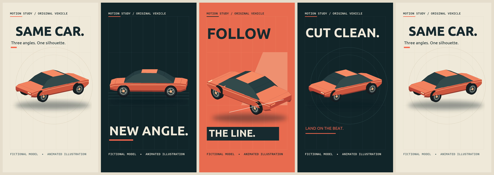

# Automotive captions editing sample

Tongshi AI created this 10-second vertical reel with an original fictional car illustration, three views, moving type and synthesized sound accents. The frame is 1080 × 1920. The first two angle changes occur at 1.367 and 2.733 seconds.

[Watch or download the MP4](https://raw.githubusercontent.com/Arron-byte/tongshi-order-csv-check/main/examples/automotive-captions/caption-reel.mp4) · [Download the English captions](caption-reel.srt)

We can edit provided footage against your script and brand guide and deliver a captioned vertical MP4 with a separate SRT. [Describe your paid trial edit](https://sqtlow7jjmgjdgncr4fhmf7pki.srv.us/consult?source=github-automotive-captions&locale=en).
