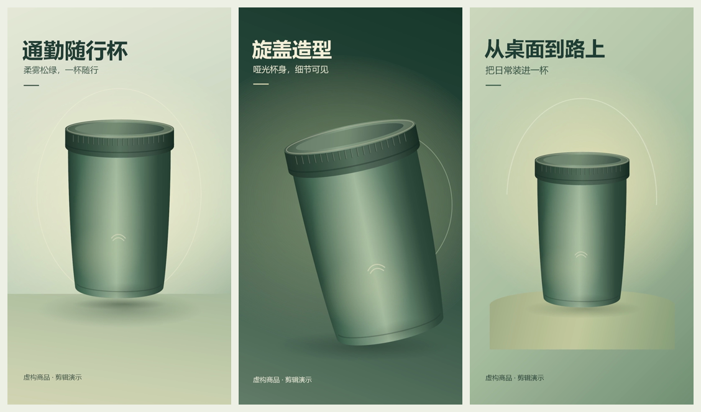

# 商品短视频剪辑样例

这条竖屏视频用原创插画演示一款虚构随行杯。片段依次呈现杯身全貌、旋盖外观和通勤主题文案。

[播放或下载 MP4](https://raw.githubusercontent.com/Arron-byte/tongshi-order-csv-check/main/examples/ecommerce-product-reel/product-reel.mp4) · [下载中文字幕](product-reel.srt)

## 单条付费试剪

260 元剪一条 15–20 秒商品短视频。你提供有权使用的商品素材和确认后的文案。交付 1080 × 1920 带中文字幕的 MP4 和独立 SRT，含一次字幕或节奏调整。双方确认范围和支付宝结算、素材齐备后，两个工作日交首剪。

[说明你的试剪需求](https://sqtlow7jjmgjdgncr4fhmf7pki.srv.us/consult?source=github-ecommerce-reel)
