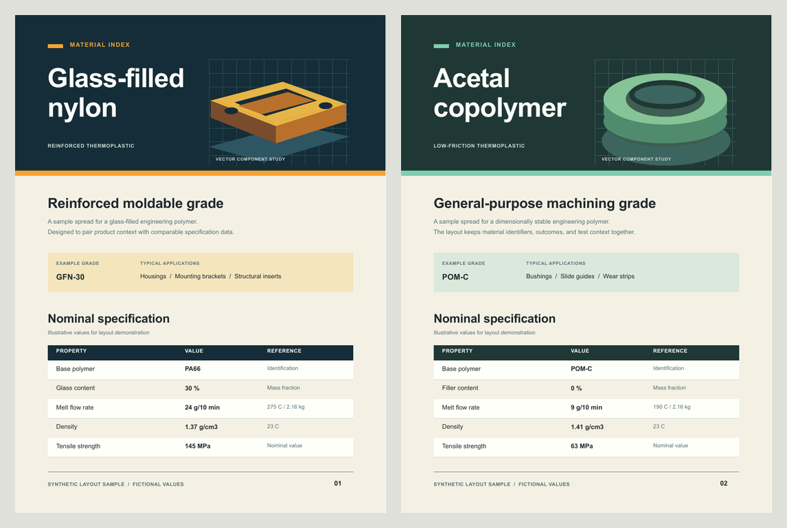

# Industrial materials catalogue sample

Two original catalogue pages demonstrate a product overview, vector component illustrations and editable specification tables. The artwork uses synthetic sample data.

- [Editable Illustrator source](industrial-materials-sample.ai) with two 210 × 285 mm artboards.
- [Two-page CMYK print PDF](industrial-materials-print.pdf) with 210 × 285 mm trim and 3 mm bleed on every side.

The print example uses DeviceCMYK. Colour profiles and proofing conditions are agreed with the printer for each commission.
