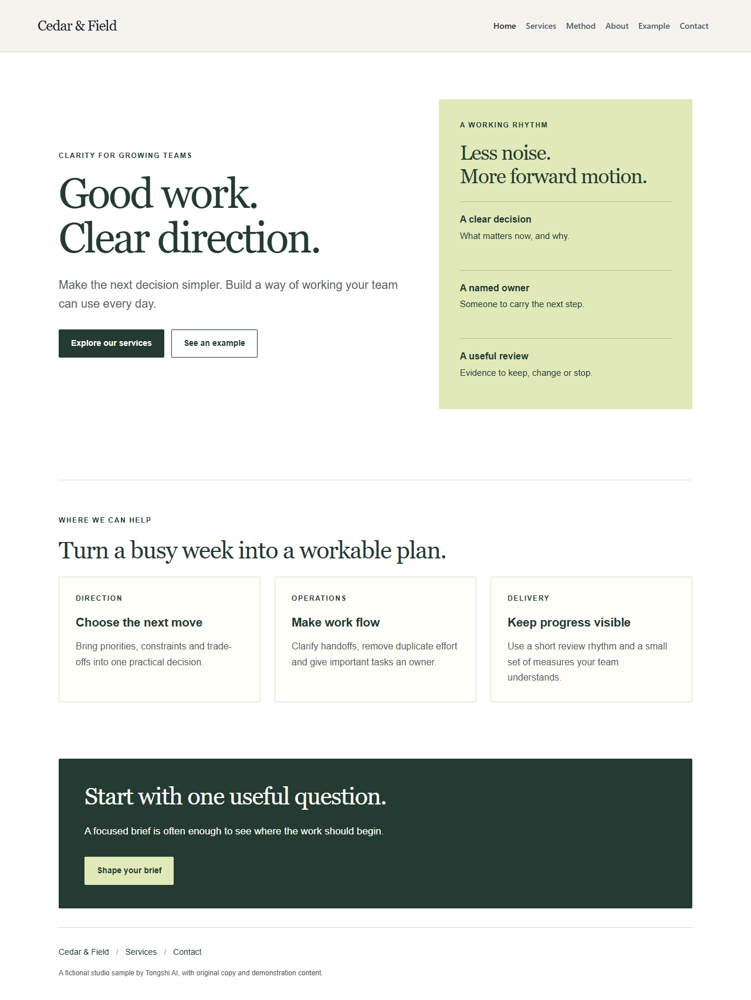

# Cedar & Field WordPress sample

Cedar & Field is a fictional management consultancy built as a six-page WordPress sample. A single navigation menu connects Home, Services, Method, About, Example and Contact. Gutenberg blocks hold the page content, with the Kadence Theme and editable Kadence Advanced Text headings.

[Open the sample in WordPress Playground](https://playground.wordpress.net/?blueprint-url=https%3A%2F%2Fraw.githubusercontent.com%2FArron-byte%2Ftongshi-order-csv-check%2Fmain%2Fexamples%2Fkadence-consulting%2Fkadence-sample.zip) or [download the blueprint](./kadence-sample.zip). Playground creates a WordPress copy in your browser. The first load fetches WordPress and the two Kadence packages. The Contact page is a writing sample with a project brief outline.

## Preview



[Mobile home page](./mobile.png) · [Gutenberg editor](./gutenberg.png) · [Local verification results](./readback.json)

## Reproduce locally

Use the WordPress Playground CLI with the downloaded bundle.

```sh
npx @wp-playground/cli@3.1.65 server --blueprint kadence-sample.zip --port 9423
```

The bundle contains the blueprint, original page content, and stylesheet. It uses Kadence Theme 1.6.0.1 and Kadence Blocks 3.9.1.2 from the WordPress.org package repository.
