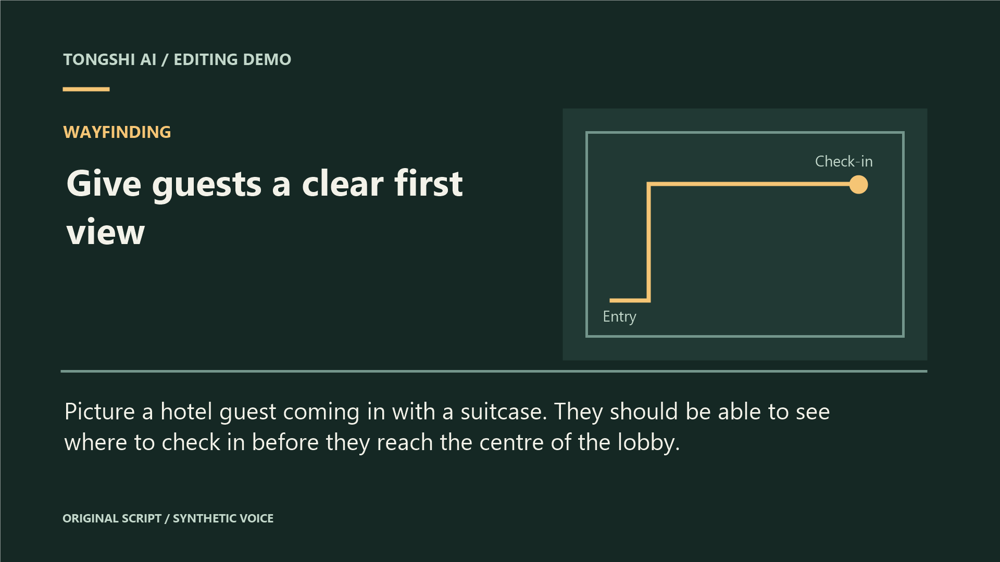

# A clearer arrival

Tongshi AI created this editing sample with an original interior-design script, diagrams and synthetic English narration. The same source recording was edited into three captioned cuts.

- Horizontal YouTube cut, 60 seconds at 1920 × 1080. [Play or download](a-clearer-arrival-youtube.mp4)
- Vertical wayfinding cut, 29 seconds at 1080 × 1920. [Play or download](a-clearer-arrival-wayfinding.mp4)
- Vertical lighting cut, 31 seconds at 1080 × 1920. [Play or download](a-clearer-arrival-lighting.mp4)

Each MP4 contains H.264 video and AAC audio. The cuts have distinct opening titles and captions timed to the narration segments.
