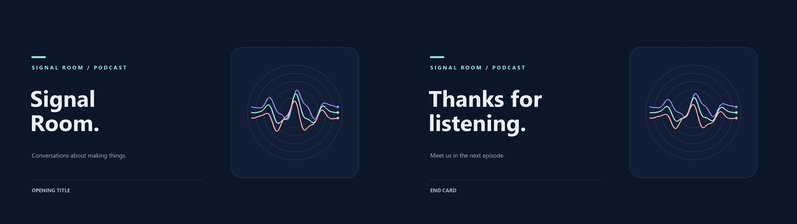

# Signal Room podcast motion cards

| Deliverable | Length | File |
| --- | --- | --- |
| Opening title | 5.5 seconds | [Opening MP4](signal-room-intro.mp4) |
| End card | 5.5 seconds | [End card MP4](signal-room-outro.mp4) |

Both clips are 1920 × 1080 H.264 MP4 at 30 frames per second. Signal Room is a fictional podcast used to show two matching cards. Tongshi AI made the text, waveform motion and layout using Pillow and FFmpeg. The clips contain original graphics and are silent.
