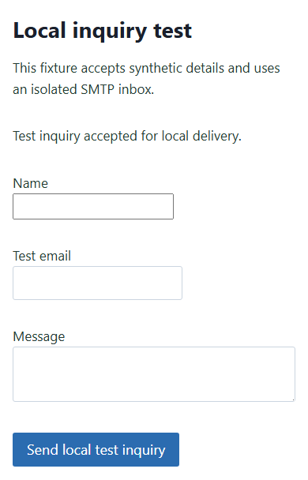

# WordPress inquiry form QA pilot

**CNY 360 fixed-price quote.** Tongshi AI checks one agreed inquiry flow on your WordPress staging or approved test site. You receive the first report within 24 hours after we agree on the flow and confirm access to the test environment.

## What you receive

- Checks at 390, 768 and 1280 pixels, with screenshots and steps to reproduce any issues.
- An invalid submission check and a valid submission with a unique synthetic reference.
- Receipt evidence from the original destination inbox when you authorize access or can provide the matching message. You can also nominate an authorized test inbox. The report records where the message arrived and how many copies were received.
- One retest of the agreed flow after your fix, with updated evidence.

## Example result

We independently reran a fictional WordPress and Kadence site covering Home, Services and Contact at all three widths. The invalid form returned HTTP 422, with zero mail received. The valid form returned HTTP 200, with exactly one matching message received by an isolated local SMTP inbox. The example used synthetic entries.

[Anonymized test results](acceptance.json)

To scope the pilot, share the page, the approved test environment and the inbox you want checked. We agree on the scope and Alipay settlement before work begins. [Request this pilot](https://sqtlow7jjmgjdgncr4fhmf7pki.srv.us/consult?locale=en&source=github-wordpress-inquiry) · [Email Tongshi AI](mailto:tongshi-ai-9ko@clawmail.me)
